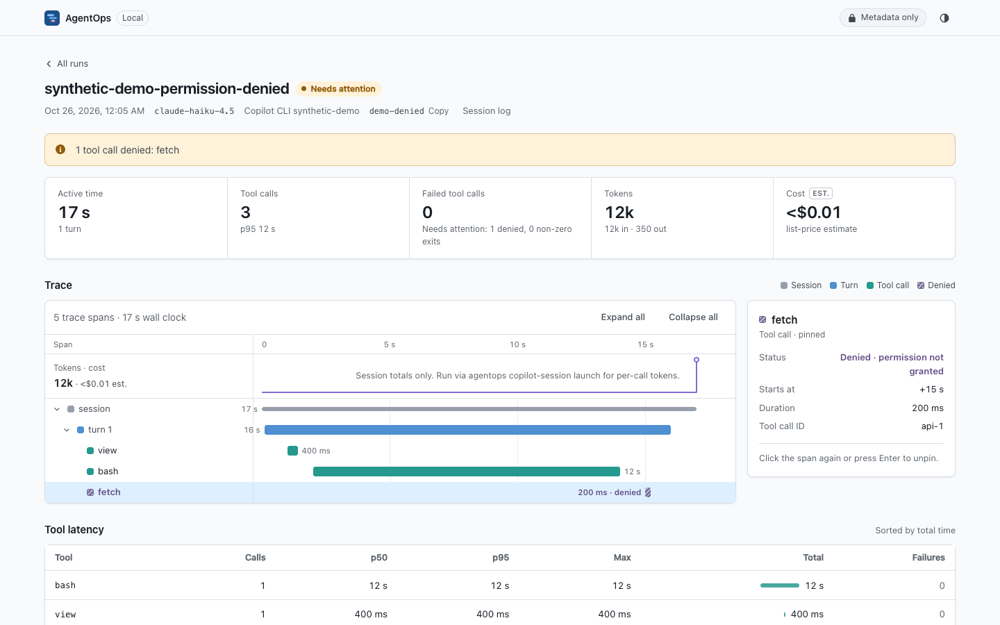
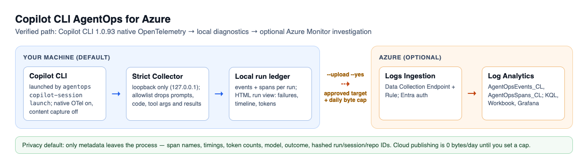

# Copilot CLI AgentOps for Azure

**Find the failed or slow tool call in a Copilot CLI run.** AgentOps turns local Copilot CLI sessions into a trace waterfall with failure details, tool latency and token use. Azure Monitor is optional, and prompts, code, tool arguments and tool results are not recorded by default.

**Who it's for:** developers building and debugging coding agents who want to see what a Copilot CLI run actually did.

> Independent open-source project. Not an official Microsoft, GitHub, OpenAI, Azure or Grafana product. Developer preview.

## Quickstart

**Try the local demo. Node.js 20+ only; no account, Azure or Docker.**

```bash
git clone https://github.com/c-mongan/copilot-cli-agentops-azure && cd copilot-cli-agentops-azure
node scripts/start-ui-demo.js
```

Open `synthetic-demo-permission-denied`, inspect the denied `fetch` call, then compare it with the 12-second `bash` step. This uses the real read-only UI with **generated sample data**, not production evidence. It reads no personal sessions and makes no model or cloud calls. Press `Ctrl+C` to stop and remove its temporary data.

<picture>
  <source media="(prefers-color-scheme: dark)" srcset="docs/images/ui-demo-synthetic-dark.png">
  
</picture>

**Inspect your own Copilot CLI sessions.** You need Node.js 20+ and the GitHub Copilot CLI, signed in.

```bash
# 1. Get the CLI (one command, no global install; npx fetches the release tarball)
alias agentops='npx --yes -p https://github.com/c-mongan/copilot-cli-agentops-azure/releases/download/v0.3.5-preview/copilot-agentops-cli-0.3.5-preview.tgz agentops'

# 2. Run an observed Copilot session (local only, no upload). In -p mode Copilot
#    cannot ask for permission, so allow tools explicitly; use a repo you trust.
agentops copilot-session launch --repo /path/to/repo --json \
  -- -p "Run the tests and explain any failure" --allow-all-tools > run.json

```

Choose one way to view the run:

```bash
# 3a. Interactive local web UI (foreground server; press Ctrl+C to stop)
agentops ui latest
```

Or write a static HTML page and open `run.html` in your browser:

```bash
# 3b. Static output (returns to the shell; reads step 2's run.json with Node.js)
agentops copilot-session view "$(node -p 'require("./run.json").sessionId')" \
  --run-id "$(node -p 'require("./run.json").runId')" --output run.html
```

With `--json`, stdout is only the run JSON; Copilot's transcript goes to stderr. `ui latest` opens the run from your most recent `launch`. See the [local web UI](docs/local-ui.md).

Prefer a source checkout? `git clone` the repository and use `alias agentops="node $PWD/agentops-cli/src/index.js"`. Each release lists its tarball's SHA256 in `SHA256SUMS`. The package is not on the npm registry yet.

## Short video overview

**21 seconds.** Recorded local UI; developer preview. Azure is optional.

[](https://github.com/c-mongan/copilot-cli-agentops-azure/releases/tag/portfolio-overview-2026-10-23)

[Watch on GitHub](https://github.com/c-mongan/copilot-cli-agentops-azure/releases/tag/portfolio-overview-2026-10-23) · [Download MP4](https://github.com/c-mongan/copilot-cli-agentops-azure/releases/download/portfolio-overview-2026-10-23/agentops.mp4) · [Transcript](docs/video-overview/transcript.txt) · [Captions](docs/video-overview/captions.srt) · [Credits and source notes](docs/video-overview/README.md)

There is also a [34-second v0.3.5 release demo](https://github.com/c-mongan/copilot-cli-agentops-azure/releases/download/v0.3.5-preview/agentops-v0.3.5-e2e.mp4); see [limitations](docs/limitations.md#v035-release-demo) for what it does and does not show.

## What it does

| Question | Where you see it |
|---|---|
| Which tool call failed or was denied, and what came before it? | Local run view, failure detail |
| Where did the time go? | End-to-end timeline, span durations |
| How many tokens did each model call use? | Run summary, `AgentOpsSpans_CL` |
| What did a run cost? | Estimated cost from public list prices (local UI and `digest`); `EstimatedCostUsd` in Azure (nullable) |
| Did Azure store exactly what was sent? | KQL readback |

Each of these was checked against real Copilot CLI runs on 2026-10-07. Costs are estimates, not billed cost. Results, caveats and the [full list of known limits](docs/limitations.md) are in the docs, and the [CLI E2E walkthrough](docs/e2e-validation.md#copilot-cli-walkthrough-2026-10-07) shows the evidence.

## Architecture



Copilot CLI emits native OpenTelemetry. A loopback-only, strict-privacy Collector receives it and AgentOps writes a local run ledger. Azure is optional: publishing is off by default (a 0-bytes-per-day cap) and goes through a Data Collection Rule into Log Analytics. You then investigate with KQL, an Azure Workbook or Grafana. Details: [architecture](docs/architecture.md) and the [full component map](docs/images/agentops-architecture-dataflow.png). Diagram source: [`docs/diagrams/agentops-cli-architecture.html`](docs/diagrams/agentops-cli-architecture.html).

Is this the right tool? Azure Monitor and Aspire already cover parts of this; see [when to use AgentOps](docs/product-scope.md) and [limitations](docs/limitations.md#comparison-with-other-tools).

## Optional: Azure upload

[](https://portal.azure.com/#create/Microsoft.Template/uri/https%3A%2F%2Fraw.githubusercontent.com%2Fc-mongan%2Fcopilot-cli-agentops-azure%2Fv0.3.5-preview%2Finfra%2Fazuredeploy.json)

To publish to your own Azure workspace, click **Deploy to Azure** (metadata-only Log Analytics, ingestion endpoint and rule, Workbook and a monthly cost alert at a budget of 5 units of your subscription's billing currency by default, set with `monthlyBudgetAmount`; it alerts but does not stop spending; see [Deploy to Azure](docs/deploy-to-azure.md)) or follow the [diagnostic pilot quickstart](docs/diagnostic-pilot-quickstart.md). Explicitly opt into upload RBAC and public network access, or configure a separately authorized sender and private connectivity. Then add `--upload --yes` with an explicit daily byte cap (`AGENTOPS_MAX_PUBLISH_BYTES_PER_DAY`), and check storage with the [KQL query library](docs/kql-query-library.md).

## Privacy by default

- **Metadata only.** Span names, timings, token counts, model names and outcomes. Repository identifiers are hashed in the ledger and in anything uploaded to Azure. The local UI, which never leaves your machine, shows your own repository folder names.
- **Not recorded by default.** Prompts, responses, source code, tool arguments and tool results. Content capture needs an explicit, separate opt-in and is meant for synthetic evaluation data only.
- **Fail-closed cloud writes.** Uploads need an explicit target, an approved subscription allowlist and a non-zero daily byte cap. The repository contains no subscription IDs or secrets.

See [privacy modes](docs/privacy-modes.md), [secure by default](docs/secure-by-default.md) and the [threat model](docs/threat-model.md).

## Known limits

AgentOps is not a hosted service, a governance platform or a security boundary, and hooks, benchmarks and advanced dashboards are experimental. Cost is an estimate, and token totals must come from `chat` spans. See [limitations](docs/limitations.md) for the full list.

## Learn more

- [Local web UI](docs/local-ui.md): runs list, span waterfall, tool latency and estimated cost
- [`agentops doctor`](docs/doctor.md): a green/red checklist of your whole setup, with a fix for each step
- [Operator guide](docs/operator-guide.md): all commands, Collector modes, Azure setup, plugin and removal
- [E2E validation](docs/e2e-validation.md): CLI and VS Code walkthroughs with screenshots
- [Weekly digest](docs/digest.md): `agentops digest` failure clusters, slow tools, tokens and trends
- [VS Code native capture extension](extensions/agentops-native/README.md)
- [Deploy to Azure](docs/deploy-to-azure.md): one-click, metadata-only workspace with a budget alert
- [Portable Grafana dashboard](docs/grafana.md): import the one file `grafana/agentops-copilot-cli.json` into the Azure portal, Azure Managed Grafana or self-hosted Grafana. The other dashboard JSONs are legacy or advanced; see [`grafana/README.md`](grafana/README.md)
- [Azure Workbook](docs/enterprise-workbook.md), [Grafana tour](docs/grafana-dashboard-tour-v2.md) and [KQL query library](docs/kql-query-library.md)
- [OpenTelemetry GenAI export](docs/otel-genai.md): send sessions to the App Insights Agents (preview) view
- [Telemetry schema](docs/telemetry-schema.md) and the [documentation index](docs/README.md)
- [Changelog](CHANGELOG.md)

Licensed under the [MIT License](LICENSE).
