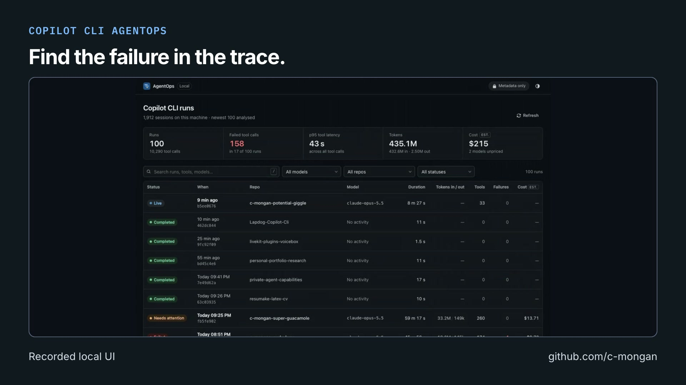

# Copilot CLI AgentOps: short video overview

[Watch on GitHub](https://github.com/c-mongan/copilot-cli-agentops-azure/releases/tag/portfolio-overview-2026-10-23) · [Download MP4](https://github.com/c-mongan/copilot-cli-agentops-azure/releases/download/portfolio-overview-2026-10-23/agentops.mp4) · [Transcript](transcript.txt) · [Captions (SRT)](captions.srt) · [Captions (VTT)](captions.vtt)

Recorded local UI; developer preview. Azure is optional.

The video introduces the project; it does not replace its validation records or documented limits.

## Media details

- Duration: 21.133 seconds; 1920 × 1080; 30 fps; H.264 video and AAC audio.
- Published video SHA-256: `62908a7c52a204c6d75c6aba0f96139d5f431a172b928a50ea205b0dd6b0c741`.
- AI narration: Inworld TTS 2, using the voice selected by the project author.
- Music: *Happy Beats / Business Moves Vol. 10* by Sascha Ende (ende.app), licensed under [CC BY 4.0](https://github.com/spdx/license-list-data/blob/main/text/CC-BY-4.0.txt); see the [bundled music attribution](https://github.com/latent-spaces/brag/blob/99a49090808cff1f42ba1fc2f939ddbf7724a4a9/skills/brag/assets/music/README.md). The track is trimmed, faded, and mixed beneath speech.
- Story and video workflow: [Brag](https://github.com/latent-spaces/brag); rendered locally with [Hyperframes](https://github.com/heygen-com/hyperframes).

## Visual sources

- [README.md](https://github.com/c-mongan/copilot-cli-agentops-azure/blob/f51074fc2e9802b7937bb6b9774eb395457a8622/README.md) — source Git blob `92de65e6f0ec20cd43e84a1012c7da454bee8827`.
- [ui-demo.gif](https://github.com/c-mongan/copilot-cli-agentops-azure/blob/f51074fc2e9802b7937bb6b9774eb395457a8622/docs/images/ui-demo.gif) — source Git blob `f723520e95ade51bd4538479f368263d6096bc94`.
